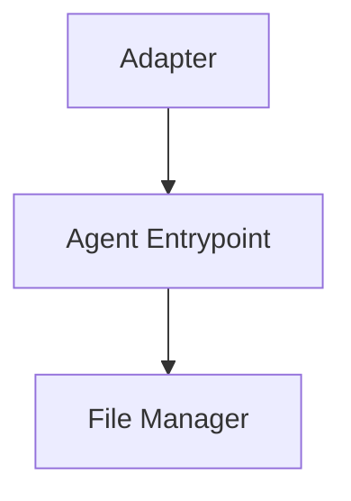

# SOP: Creating an Emerging Metamodel for a QMD Workspace

## Purpose

This procedure guides you through creating a minimal but effective metamodel for a QMD workspace. The goal is to make the workspace navigable, searchable, and useful — for both humans and LLMs — without over-ontologizing.

## Companion Reference

**Before starting:** if you have not already read the current QMD Guide in this session, call the `qmdc` MCP tool **`qmdc_get_guide`** (no arguments) and read it before proceeding.

This SOP describes the **process** of creating a metamodel; the QMD Guide is the version-current reference for **QMD syntax, validation, and CLI usage**. The two work together — this SOP tells you what to do, the guide tells you how to write it.

This SOP is self-contained and detachable: it does not depend on any local guide file. Wherever it says "see the QMD Guide", use the guide loaded from MCP. If the MCP server is not available, use the actual CLI surfaces: `qmdc parse`, `qmdc rebuild`, `qmdc query`, and `qmdc workspace parse|validate` (`qmdc` has no top-level `lint` or `refs` command).

**One parser.** Never extract QMD objects, fields, references or hierarchy with regex,
Markdown heuristics, or your own parser. Use the qmdc MCP (`qmdc_describe_object`,
`qmdc_query_sql`, `qmdc_traverse_graph`, `qmdc_find_references`,
`qmdc_validate_references`) or the qmdc CLI parser. In particular, query the resolved
`edges` table instead of scraping `[[#references]]` from source text: only qmdc owns the
rules for namespaces, hierarchical ids and ambiguity. The linter also compares qmdc's own
workspace `files[]` manifest with qmdc's object index: a discovered file producing no object
is `source_unparsed`, so invalid UTF-8 or another parser-side omission cannot look clean.
QMD source symlinks and symlinked directories are refused as `source_symlink` before qmdc
runs, so a workspace cannot redirect the parser to bytes outside its real root. QMD source names are likewise
case-sensitive: use lowercase `.qmd.md`; a case variant such as `.QMD.MD` is
`source_bad_extension` rather than a silently ignored model file.

**Getting the current version of this procedure.** It ships inside the `qmdc-model` package: `qmdc-model sop` prints it, `qmdc-model sop --path` gives its path on disk. Read it from there rather than from a copy committed into a project — the procedure is version-locked to the constraint vocabulary the linter actually enforces, and a project-local copy silently falls behind it.

**SQL note.** The Step 6 checks and time-queries below run against the `objects` and `edges` tables; for their columns and the edge model see `qmdc_get_guide` (*Workspace*, *Typed Edges*, *CLI*). Three gotchas that make or break every query:

- Object fields are **not** columns — they live in the `data` JSON. Use `json_extract(data, '$.field')`.
- Join `objects` to `edges` on `__global_id`, never on `__id`.
- Filter relationships by `edge_type` (the column is `edge_type`, not `field_name`).
- In SQL `LIKE '__%'`, each underscore is a wildcard — it does **not** mean “starts with
  two literal underscores.” To exclude qmdc's system Kinds, use
  `substr(__kind, 1, 2) != '__'` (or escape `_` explicitly).

## When to Use

- Starting a new QMD workspace
- Existing workspace feels unnavigable (can't find things, graph is noise)
- Switching domain or restructuring a project

## Prerequisites

- A QMD workspace exists (or you're about to create one)
- You understand the domain you're modeling (even roughly)
- The `qmdc` toolchain is available — either the `qmdc` MCP server (preferred: `qmdc_get_guide`, `qmdc_query_sql`, `qmdc_validate_references`, etc.) or the `qmdc` CLI. Examples below show the CLI form; the MCP tools accept the same SQL.
- The `qmdc-model` CLI is available (`uv tool install qmdc-model`; when developing from this source tree, use `uv run --project <qmdc-model-repo> qmdc-model ...`). It operates on the metamodel: `qmdc-model init <workspace>` creates the workspace directory if needed, scaffolds its root `readme.qmd.md` and the `_metamodel` namespace, and vendors the base meta-kinds; `qmdc-model upgrade <workspace>` re-vendors them after the tool is updated; `qmdc-model lint <workspace>` runs the two-phase metamodel checks (Step 6); `qmdc-model sop` prints this procedure.

---

## Step 1: Identify Anchor Entities

**Goal:** Produce a flat list of 5–15 "real things" in your domain.

**What is an anchor:** An entity that you'd naturally mention in conversation about the system. Not a document, not a section, not a formatting construct — a thing that exists in the domain.

**Two kinds of metamodel — decide which you're building first (or run both side by side):**

- **Technical / architecture metamodel** — the things you build and run: `Module`, `Service`, `Contract`, `Resource`, `DeployUnit`, `Release`. Answers "how is the system built and how does it evolve".
- **Domain metamodel** — the things the product is *about*: `User`, `Chat`, `Agent`, `Message`, `Account`, `Subscription`. Answers "what real-world concepts does the system manipulate".

They don't compete — a mature workspace usually has both (often in separate namespaces) and links across them (`Agent` domain entity realized by `agent_entrypoint` module). This SOP's running example is a technical metamodel; the same steps apply to a domain one, just with domain Kinds.

**How to do it:**

1. Ask yourself: "If I had to explain this project to someone in 2 minutes, what nouns would I use?"
2. Write each noun down as a Kind (PascalCase)
3. For each Kind, write a one-line definition
4. Stop at 15. If you have more, you're going too deep.

**Granularity matters:** Err on the side of coarse. A reference document about QMD might start with 14 fine-grained anchors (Object, Field, DataType, Reference, Parser, ...) but work better with 5 coarse ones (Syntax, Reference, Workspace, Validation, CLI). The right granularity depends on the purpose: if the goal is navigation and iteration, fewer anchors with clear boundaries beat many overlapping ones.

**Human-in-the-loop:** In an interactive run, an AI agent MUST propose the anchor list to
the human and get explicit approval before proceeding. Do not guess the metamodel in
isolation. A wrong metamodel is worse than no metamodel — it creates structure that
actively misleads. Present the list, explain your reasoning for each anchor, and iterate
until the human confirms.

There is one explicit autonomous path: if the caller delegated end-to-end metamodel
construction and no human response can arrive during the run, write the proposed list into
`_metamodel/readme.qmd.md`, label it **provisional — human review pending**, and continue so
the delegated run can produce a reviewable workspace. Do not claim the metamodel was
approved; surface that one review gate in the final report. A background agent may not
silently interpret mere absence of a human as approval.

**Example — a versioned architecture project (the running example for this SOP):**

The system has a vision, modules that evolve through versions, contracts between modules, and releases that commit to specific version sets. Four layers: System Vision → Release Vision → Version specs → Committed releases.

```markdown
## Anchor Kinds [[anchor_kinds: text]]

| kind            | definition                                                        |
| --------------- | ----------------------------------------------------------------- |
| SystemVision    | High-level architectural vision: purpose, principles, target shape |
| ReleaseVision   | Planned composition of a specific version before commit            |
| Module          | Stable architectural entity that preserves identity through time   |
| ModuleVersion   | Concrete versioned specification of a module                       |
| Contract        | Stable interface seam between modules (identity, not shape)        |
| ContractVersion | Concrete versioned shape of a contract                             |
| Resource        | External infrastructure or service consumed by the system          |
| ResourceVersion | Concrete versioned specification of how a resource is used         |
| Release         | Committed consistent slice: selected module and contract versions  |
```

Note: 9 Kinds, not 15. The four-layer structure (Vision → Release Vision → Versions → Release) is the backbone. Modules and Contracts are lineages; their Versions are the concrete specs. Resources are external dependencies the system consumes but doesn't own.

**Result:** the anchor registry — a Kind table like the one above — in the workspace's
`_metamodel/readme.qmd.md` (see *Where the Metamodel Lives*), approved by the human.

---

## Step 2: Create Anchor Objects

**Goal:** For each anchor Kind, create the actual objects that exist in your project right now.

**How to do it:**

1. For each Kind from Step 1, list the concrete instances
2. Give each a human-readable ID (lowercase, underscores) — NOT auto-generated
3. Add only the fields that object's KindSchema promises; put longer explanation in named
   `text` children (`Role`, `Responsibility`, `Rationale`, ...)
4. Place related anchors in the same file or folder by domain area

**Critical file-heading rule.** QMD heading levels establish parent/child identity. In an
ordinary object file, all independent domain objects must be siblings at the same heading
level (the examples below use `##`). If the file needs a visual title above them, write a
plain Markdown heading **without** `[[id: Kind]]`. Never wrap the file in `# Title
[[title: NarrativeDoc]]` and put independent objects underneath: qmdc will correctly parse
them as children (`title.adapter`, `title.contract`), changing every id. Neither structural
validation nor reference validation can call that a mistake — it is valid QMD with the
wrong meaning — so the author must choose the hierarchy deliberately.

```markdown
# Architecture lineages          <!-- visual title only: no QMD object -->

## Adapter [[adapter: Module]]   <!-- top-level domain object -->

## API [[api: Module]]           <!-- its sibling, not its child -->
```

The workspace and namespace `readme.qmd.md` files are the exception: their H1 is the real
`__Workspace` / `__Namespace` root, so objects below it intentionally belong to that
container. For an authored domain parent with real child objects, use consecutive levels
(parent `##`, child `###`); do not skip from an H1 object to H3 — qmdc 1.0.7 rebuild can
drop that nested object, which the authored-file round-trip check in Step 6 is meant to
catch.

**Example.** Create the lineage anchors (stable identities), then the versioned specs and vision/release objects that reference them:

```markdown
## Adapter [[adapter: Module]]

### Role [[role: text]]

Translates external protocols into internal invocations

### Expected Evolution [[expected_evolution: text]]

Will grow to support multiple protocol families

## Invocation Contract [[invocation_contract: Contract]]

### Role [[role: text]]

Defines how modules request work from each other

## Adapter v1 [[adapter_v1: ModuleVersion]]

- module: [[#adapter]]
- status: active
- depends: [[#invocation_contract_v1]]

### Responsibility [[responsibility: text]]

HTTP-only protocol translation

## System Vision [[system_vision: SystemVision]]

- modules: [[#adapter]], [[#file_manager]]
- contracts: [[#invocation_contract]], [[#file_access_contract]]

### Purpose [[purpose: text]]

Multi-module AI agent platform

## Release v1 [[release_v1: Release]]

- included_modules: [[#adapter_v1]]
- included_contracts: [[#invocation_contract_v1]]
- absent: [[#file_manager]]
```

The full set of fields per Kind (Resource, ContractVersion, ReleaseVision, deltas, provisional parts) is spelled out in Step 2.5.

**ID convention rules:**
- Use `snake_case`, not camelCase
- Make it guessable: `adapter`, not `module_001` or `ad`
- Keep it stable: don't rename IDs unless the thing itself changes

**Describe each Kind with a KindSchema.** Introducing a Kind and not describing it leaves
its objects completely unchecked — and a one-character Kind typo would disable every
constraint. For every domain Kind, author a `KindSchema` in `_metamodel` (see *Where the
Metamodel Lives*): its `required`/`optional` fields, `strict` if the Kind is closed, Field
Constraints — enum literal lists for scalars, target-Kind via references to the target's
KindSchema for reference fields — and count bounds where a field has them. Exactly one
KindSchema may claim a given Kind, workspace-wide: Kind names are global, so two competing
schemas are `duplicate_kind_schema` — one diagnostic per claim, each at its own file and
line and naming every claimant by global id — not an intersection of constraints. Two
extensions that both want an `Issue` therefore prefix the Kind (`sentry.Issue`,
`git.Issue`); nesting their metamodels in different namespaces does not make the bare name
theirs. Cross-object
invariants that a per-field schema can't express become `LintRule`s. The exact vocabulary
and syntax for all of this is in *Declaring Constraints and Rules* below. In a workspace
created by `qmdc-model init`, an observed domain Kind with no KindSchema is
`missing_kind_schema` and lint fails. This is what makes a described Kind self-documenting
and machine-checked.

**Result:** QMD files with all anchor objects, each having an explicit `[[id: Kind]]` and
a `KindSchema` describing that Kind in the owning `_metamodel`.

---

## Where the Metamodel Lives: the `_metamodel` Namespace

**Goal:** keep the metamodel (the schema layer — KindSchemas, LintRules) physically
separate from the model (the domain objects — the actual Runs, Modules, Users, ...).

**Rule:** a workspace (or any namespace with a non-trivial model) puts its metamodel in
a nested `_metamodel` namespace — a `_metamodel/` folder whose `readme.qmd.md` declares
`[[_metamodel: __Namespace]]`. Domain objects live in the workspace root and other
namespaces; their schemas live under `_metamodel`.

**Bootstrap:** run `qmdc-model init <workspace>` to create this layout — it creates the
directory if it does not exist, writes the workspace-root `readme.qmd.md` (a
`__Workspace` object whose id is the directory name in snake_case), the
`_metamodel/readme.qmd.md` skeleton, and vendors the base meta-kinds as
`metaschema.vendor.qmd.md`. The result lints clean immediately. It skips files that
already exist, so it is safe to re-run. Then fill in the root `description` and add your
own KindSchemas/LintRules to `_metamodel/readme.qmd.md`.

```text
my-workspace/
├── readme.qmd.md                    # __Workspace — thin: name, description, pointer
├── <domain objects ...>             # the model (instances)
└── _metamodel/                      # the metamodel (schema layer)
    ├── readme.qmd.md                # [[_metamodel: __Namespace]] + this workspace's own KindSchemas + LintRules
    └── metaschema.vendor.qmd.md     # vendored base meta-kinds (see below)
```

**Per-namespace, not central.** A namespace owns the Kinds it introduces — declare them
locally, next to what they describe, not in one central pile. For a workspace with
several namespaces, each non-trivial namespace gets its own `_metamodel` directory; `init`
creates only the root one, so create nested ones as ordinary namespace folders:

```text
foo/
├── readme.qmd.md                    # # Foo [[foo: __Namespace]]
└── _metamodel/
    └── readme.qmd.md                # # Foo Metamodel [[foo._metamodel: __Namespace]]
```

The nested metamodel id is the owning namespace id plus `._metamodel`; plain
`[[_metamodel: __Namespace]]` would collide with the root metamodel's workspace-unique id.
That name is load-bearing for rules: `LintRule`s are only accepted in a metamodel namespace
(or the workspace root), and the placement fixes how far they reach — a rule in
`foo._metamodel` judges `foo` and its descendants, a rule in the root `_metamodel` judges
the whole workspace. A rule declared elsewhere, including in a metamodel folder named
something else, is `rule_bad_placement` and does not run (see *Declaring Constraints and
Rules*).
Do **not** copy `metaschema.vendor.qmd.md` there: vendored base kinds exist once per whole
workspace. `qmdc-model upgrade` finds that one copy from every namespace.

Kinds used by several namespaces go in their nearest common ancestor's `_metamodel`.
Apply the same ownership rule to LintRules: a rule local to one Kind belongs beside that
Kind; a rule spanning Kinds from different namespaces belongs in their nearest common
ancestor's `_metamodel`. An instance whose meaning spans namespaces (for example, a
Contract between modules in `ingest` and `processing`) likewise belongs in the nearest
common ancestor — usually the workspace root. From a nested namespace, a bare reference
`[[#root_object]]` reaches a uniquely named root object; qualify references into another
namespace (`[[#foo:object]]`, including dotted namespace ids such as
`[[#foo._metamodel:schema_bar]]`). To reference the namespace object itself, use an empty
workspace-namespace component: `[[#:foo]]` (not `[[#foo:foo]]`). A subfolder does not create
a namespace by itself: without its own namespace-declaring `readme.qmd.md`, files inherit
the nearest ancestor namespace — useful for `releases/v1/`, `releases/v2/` folders that
remain inside one `releases` namespace.

**Vendoring.** The base meta-kinds every schema depends on — `KindSchema`,
`FieldConstraints`, `Cardinality`, `FieldCardinality`, `LintRule` — are not redefined per
project. They are *vendored*: copied in as `*.vendor.qmd.md` files inside `_metamodel`
(one file is fine, e.g. `metaschema.vendor.qmd.md` — do not split one file per Kind).
`qmdc-model init` writes this file and `qmdc-model upgrade` keeps it current: the tool
OWNS every `*.vendor.qmd.md`, creating, rewriting and deleting them to match the installed
version, so a hand edit is always lost (`init` will not update an existing one — it skips
what exists). Ownership stops at the real workspace tree: `init`/`upgrade` refuse a
symlinked `_metamodel`, a symlinked or non-regular vendor path, and an unwritable plan
instead of following it or partially mutating files. Vendor it as ONE copy per workspace
even though `_metamodel` namespaces are many: the base meta-kinds carry fixed object ids, so a second copy makes every reference
inside them ambiguous, and the linter finds the surviving one by `__kind` from anywhere.
Vendoring makes a workspace self-contained so the linter's phase-1 (validate the
workspace's own KindSchemas / LintRules against the base meta-kinds) runs offline.

**Placement is organizational only.** The linter finds `KindSchema` / `LintRule` objects
by `__kind` anywhere in the workspace — the `_metamodel` namespace is for human clarity
and the metamodel/model split, not a requirement the tool enforces.

**Result:** a workspace whose schema layer is isolated in `_metamodel`, self-contained
via vendored base kinds, and navigable (the metamodel is one namespace, the model is the
rest).

---

## Declaring Constraints and Rules

**Goal:** express a check declaratively, in the schema, so `qmdc-model lint` enforces it —
and reach for a `LintRule` only when no per-field constraint can say it.

**The vocabulary.** Everything the linter enforces, and where it is declared:

| constraint    | declared as                                              | violation code          |
| ------------- | -------------------------------------------------------- | ----------------------- |
| `required`    | `- required: [a, b]` on the KindSchema                    | `missing_required`      |
| `optional`    | `- optional: [c]` on the KindSchema                       | —                       |
| `strict`      | `- strict: true` — QMD boolean only; no field beyond required+optional | `unexpected_field`      |
| `enum`        | a literal list in Field Constraints: `- status: [a, b]`   | `enum_violation`        |
| `target_kind` | a reference in Field Constraints: `- owner: [[#schema_person]]` | `target_kind_violation` |
| `min_count`   | `- min_count: 2` on a FieldCardinality child              | `min_count_violation`   |
| `max_count`   | `- max_count: 4` on a FieldCardinality child              | `max_count_violation`   |

**Field names are strings.** `required` / `optional` may be one scalar field name or a
list of field-name strings; numbers, booleans, references, nested objects, empty entries and
prose containing whitespace are `schema_field_list`. A field cannot be both required and
optional. On a `strict: true` Kind, remember that a heading-syntax text child such as
`### Role [[role: text]]` becomes its parent's real `role` field, so declare it in
`required`/`optional` too. `strict` itself must be the QMD boolean `true` or `false`;
`yes`, `True` as a quoted string, `1`, and other truthy-looking prose are
`schema_bad_strict`, never silently treated as open.

**Field Constraints** is exactly one nested `FieldConstraints` child whose id is literally
`constraints`; a friendly id such as `widget_constraints` is not attached to the
KindSchema and is `schema_bad_child`. `[FieldConstraints]` arrays are likewise never merged
or partially applied. An entirely empty FieldConstraints child is also
`schema_empty_constraint`: remove it until at least one rule exists. Its keys are field
names of the described Kind. Every entry must contain either a
non-empty literal enum list or one/more KindSchema references; `- field:` with no value is
`schema_empty_constraint`, never an empty enum blamed on every domain object:

```markdown
## Meeting [[schema_meeting: KindSchema]]

- kind: Meeting
- required: [title, participants]
- optional: [status]

### Field Constraints [[constraints: FieldConstraints]]

- status: [planned, held, cancelled]
- participants: [[#schema_person]]
```

Every constrained field must first appear in the KindSchema's `required` or `optional`
list. The two value modes are exclusive end to end: an enum-constrained domain field must
hold literals; a target_kind-constrained field must hold resolved references. A polymorphic
reference field may list several allowed KindSchemas (`- about: [[#schema_module]],
[[#schema_contract]]`). Switching form is `constraint_value_shape`, not a way to opt out of
validation. Every target_kind reference must point to a `KindSchema`, not to an instance.

**Cardinality** is exactly one `Cardinality` child whose id is literally `cardinality`
(not `counts`, `widget_cardinality`, or a `[Cardinality]` array), with at least one nested
FieldCardinality object. An empty Cardinality bag is `cardinality_bad_shape`. For each
constrained field, the `FieldCardinality` object's **id is the field name**, and
`min_count` / `max_count` are plain integers on it. Those are the **only** allowed fields
on a FieldCardinality child; `mincount`, `minimum`, prose children, etc. are
`cardinality_bad_shape`. Do not write `- participants: 2`
inline on the Cardinality container — that is a malformed shape (`cardinality_bad_shape`),
not a shorthand.

```markdown
### Cardinality [[cardinality: Cardinality]]

#### participants [[participants: FieldCardinality]]

- min_count: 2
- max_count: 8
```

A reference field counts **distinct resolved targets** from qmdc's edge index; writing the
same target twice still counts as one participant/dependency. A parsed list field counts
its items, and any other non-empty value counts as one. Cardinality constrains the values a
field *holds*, not whether the field is there — an absent field is `required`'s business, so
a minimum on an absent optional field stays silent. Bounds must be non-negative integers
and `min_count` cannot exceed `max_count`; malformed or inverted declarations are errors in
the metamodel, never silently ignored.

All three helper Kinds are placement-sensitive: FieldConstraints and Cardinality are direct
children of a KindSchema; FieldCardinality is a direct child of Cardinality. A correctly
named but loose/mis-nested bag is `schema_bad_placement`, never inert scaffolding.

**LintRule** is for what a per-field constraint cannot express — a relation between two
fields, or between objects. Required fields: `severity`, `assert`, `message`. Plus
**exactly one** scope selector:

- `for_each: <Kind>` — every object of that Kind
- `for_each_with: <field>` — every **domain** object that has that field (qmdc system
  objects and the five base metamodel Kinds are excluded; use `for_each: KindSchema` etc.
  when configuration objects are intentional)
- `global: true` — evaluated once with no current object; use `all_of()` / `refs_of()` /
  `exists()`, not current-object helpers such as `field()` or `refs()`

**Where you declare a rule is how wide it reaches.** A rule governs the namespace
**enclosing** the namespace it is declared in: a metamodel nested under `a`
(`a._metamodel`) judges `a` and its descendants, and the workspace root metamodel
(`_metamodel`) judges the whole workspace. That bound applies to all three selectors at
once — which objects the rule judges, which field names its assert may name, and what
`all_of()` enumerates. Reference traversal is deliberately *not* bounded: `refs()`,
`target()`, `targets()` and `incoming()` still cross namespaces, because a rule judging
one namespace's object may need evidence from another.

Those two scopes are the only ones available, because a `LintRule` must be declared **in a
metamodel namespace** — `_metamodel` at the workspace root, `<owner>._metamodel` beneath
the namespace it describes — or in the workspace root itself, where there is nothing wider
to reach. A rule sitting anywhere else (beside its own domain objects, or in a metamodel
folder renamed to something else) is `rule_bad_placement`: an error, and the rule does not
run. That refusal is the point — an unrecognized home would otherwise be handed the
enclosing namespace, usually the whole workspace, and would judge other extensions' data
with the blame landing on their files.

So a per-extension package ships its Kinds and rules in its own nested `_metamodel` and
cannot make a project's lint red on a sibling extension's data, nor have its own rule
invalidated by a field only a neighbour uses. A rule that genuinely must judge the whole
workspace belongs in the workspace root metamodel — that is the opt-out, and there is no
flag for it. Two consequences worth expecting: a scoped rule whose namespace has no data
yet reports `rule_empty_scope` (info) instead of quietly finding matches elsewhere, and a
field name that exists only outside the scope is `rule_unknown_field` on the rule.

```markdown
## Release Vision Must Include Something [[rule_vision_contents: LintRule]]

- for_each: ReleaseVision
- assert: has('included_modules') or has('included_contracts')
- severity: error
- message: release vision {id} includes no module or contract versions
```

`{id}` in a rule's human message is replaced by the object's qmdc `__id` (concise and
possibly namespace-local); structured diagnostics also carry `global_id`, and the
expression helper `id` below is that unambiguous global identity. Declaring no selector,
an unsupported `for_each*` selector, or more than one selector is an error in the
metamodel; the rule does not run. `assert` must be a **string expression** like
`count('participants') >= 2` — bare QMD booleans (`assert: true` / `false`) are values,
not expressions, and produce `rule_eval_failed`. If evaluation raises, that is also
`rule_eval_failed` (broken rule), distinct from `rule_failed` (valid rule, bad data).
`severity` is exactly one of `error`, `warning`, `info`; `message` is a non-empty string;
`for_each` must name a declared or observed Kind. A field literal in `field()` / `has()` /
`refs()` / `count()` / `target()` / `targets()` must be declared by that KindSchema or
observed on one of its objects — a typo is `rule_unknown_field` on the rule, not a false
violation on every domain object.

The expression is a deliberately small, side-effect-free language, not arbitrary Python.
Boolean/comparison expressions, fixed list/tuple/set/dict literals, conditionals, indexing,
and the safe string/dict methods `get`, `startswith`, `endswith`, `lower`, `upper`
are supported. Use `sum([...])` for a numeric total; binary operators such as `*` and `+`
are intentionally absent because Python also applies them to strings/lists and can amplify
a tiny assertion into an unbounded allocation. Lazy generator expressions are supported
only as input to `all()`, `any()` or one-argument `sum()` (`sum(generator, start)` is
forbidden because a list/tuple start materializes repeated concatenation), with at most two
total generators (enough for a pairwise cross-object check). Inside a comprehension,
`all_of()` may appear only in a generator iterator, never in its condition/body — reading
the whole workspace again for every pair turns a quadratic rule cubic. Materializing
list/set/dict comprehensions are rejected.
Imports, lambdas, arbitrary attributes (`__class__`, `__subclasses__`), file/process APIs,
and unknown names/calls are rejected before evaluation. Do not put operations with side
effects in a LintRule.

**Assert helpers.** References come from qmdc's already-resolved edge graph and are global
object identities, so `refs()` output can be passed straight to `exists()` / `kind_of()`
and every helper works across namespace boundaries.

| expression | returns | meaning |
| ---------- | ------- | ------- |
| `field('name')` | any value or `None` | qmdc-parsed field value |
| `has('name')` | bool | field exists and is non-empty |
| `refs('field')` | list[str] | distinct resolved global ids referenced by this field |
| `count('field')` | int | distinct resolved reference count, parsed list length, or 1 for another non-empty value |
| `target('field')` | object dict or `{}` | first resolved target |
| `targets('field')` | list[object dict] | all resolved targets |
| `kind_of(id)` | str or `None` | target Kind; accepts an id returned by `refs()` |
| `exists(id)` | bool | whether that identity resolves uniquely |
| `incoming(kind=None, via=None)` | list[object dict] | objects pointing at current object; `via` filters qmdc `edge_type` (link role such as `about`), not `source_field` |
| `all_of('Kind')` | list[object dict] | every object of that Kind inside the rule's namespace scope |
| `refs_of(obj, 'field')` | list[str] | resolved global ids in another object's field |
| `id_of(obj)` | str | global identity of a resolved object; absent/unresolved input is `rule_eval_failed`, never an empty shared id |
| `overlaps(left, right)` | bool | parsed list/set collections of scalar members share an item; strings/object dicts are `rule_eval_failed` |
| `same_members(left, right)` | bool | set equality for two scalar parser lists/reference lists |
| `is_subset(left, right)` | bool | whether every scalar parsed member on the left occurs on the right |
| `id` | str | current object's qmdc `__global_id` (safe to pass to `exists` / `kind_of`) |

Standard `len`, `all`, `any`, one-argument `sum`, `str`, `int` and `bool` are available.
General `list`/`set`/`dict`/`sorted` coercions are deliberately absent: applying them to a
scalar string creates a character collection and destroys the parser's value-type
provenance. Use the typed predicates above instead. Example:
`len(incoming(kind='ModuleVersion', via='module')) > 0` — note that `incoming()` returns a
**list**, not a count. In a pairwise rule, compare `id_of(a)` and `id_of(b)` to distinguish
the two parser objects; do not rely on undocumented dict metadata. To reject two bookings
sharing any table, use `not overlaps(refs_of(a, 'tables'), refs_of(b, 'tables'))` inside the
pairwise rule — no third generator is needed. qmdc's edge index
deduplicates equal references, so `refs()` and the
reference branch of `count()` see **distinct resolved targets**: do not write
`count('f') == len(set(refs('f')))` as a duplicate check — it is a tautology. Duplicate
source references are not expressible through this LintRule vocabulary.

**Retiring an object.** `lifecycle` is the reserved linter-control field and is implicitly
allowed even on a `strict: true` Kind — do not add it to every KindSchema's `optional`
list. An object with `- lifecycle: removed` is skipped by every schema check and every
rule. Its ordinary domain `status` remains available for values such as `planned`,
`active`, `failed` or `removed`; **no status value controls the linter**. To retire an
object, write `lifecycle: removed` explicitly. Retirement applies to domain objects,
KindSchemas and LintRules — never to FieldConstraints/Cardinality/FieldCardinality helper
bags (`lifecycle_bad_value`). Any other value/casing (`Removed`, `active`,
`true`) is `lifecycle_bad_value`; use a domain field such as `status` for lifecycle states.
Lint emits `retired_object` at info severity
and skips that object's schema/rule checks, so disabling validation remains visible. A
retired LintRule does not execute, but its configuration is still
validated and lint emits `retired_rule` at info severity — disabling a rule is visible, not
a way to hide malformed configuration.

**Result:** checks live in the metamodel where the linter and CI enforce them, instead of
in a reviewer's head or a one-off query.

---

## Step 2.5: Version the Architecture in Time

**Goal:** Turn a static architecture description into a time-aware structure: one long-lived `SystemVision`, one `ReleaseVision` per planned version, versioned module/contract specs, and committed `Release` slices.

**When to use:** the system is built incrementally — some modules don't exist early, contracts are intentionally provisional at first, and you need to describe both "what we plan for version N" and "what actually shipped". Skip this step for a static, single-version system.

**Why it exists:** a plain metamodel captures only *what exists now*. Without the four layers, `SystemVision` bloats with detail, `Release` mixes plan with fact, and modules/contracts look static even as they evolve.

---

### What to create

**1. One `SystemVision`** — the long-lived architectural intent (not a release plan): purpose, principles, target shape, and references to the expected `Module` and `Contract` lineages.

**2. Stable `Module`, `Contract`, and `Resource` anchors** — identity lineages, not version snapshots. Each carries role, physical location, and expected evolution. Physical location lives on the lineage anchor because it's stable across versions (the adapter is Python in `src/adapter/` whether it's v1 or v5); `Resource` covers things you depend on but don't build (`dynamodb`, `s3`, `bedrock`).

```markdown
## Adapter [[adapter: Module]]

### Role [[ad_role: text]]

Translates external protocols into internal invocations

### Physical Location [[ad_location: text]]

- path: src/adapter/
- language: Python
- package: tg_acp.adapter

### Expected Evolution [[ad_evolution: text]]

Will grow to support multiple protocol families
```

**3. Versioned specs: `ModuleVersion` / `ContractVersion` / `ResourceVersion`** — create one whenever behavior, public surface, dependencies, or guarantees materially change.
- `ModuleVersion`: `module` (parent), `status`, responsibility, public surface, dependencies, deferred parts, delta from previous.
- `ContractVersion`: `contract` (parent), participants, semantics, guarantees, allowed simplifications, compatibility, delta from previous.
- `ResourceVersion`: only when usage of an external resource changes (new table, new GSI, bucket layout). Most releases need none.

**4. Planned slices: `ReleaseVision`** — the planned composition of version N *before* commitment: intended scope, intended module/contract versions, expected absences, acceptable provisional parts, expected upgrade from previous. This is the layer that's easy to miss, sitting between `SystemVision` and `Release`.

**5. Committed slices: `Release`** — the actually-shipped set: included module/contract versions, absent parts, provisional parts, assembly assumptions, and `git_tag` (`(pending)` until the repo is tagged, then the tag name — the permanent link to the code snapshot). Keep `ReleaseVision` (plan) and `Release` (committed fact) as separate objects.

---

### Recommended link structure

Use links like:

* `SystemVision -> modules -> Module`
* `SystemVision -> contracts -> Contract`
* `ModuleVersion -> module -> Module`
* `ContractVersion -> contract -> Contract`
* `ReleaseVision -> intended_modules -> ModuleVersion`
* `ReleaseVision -> intended_contracts -> ContractVersion`
* `Release -> included_modules -> ModuleVersion`
* `Release -> included_contracts -> ContractVersion`
* `SystemVision -> resources -> Resource`
* `ResourceVersion -> resource -> Resource`

You do not need to introduce all of these as formal link roles immediately. Some may begin as ordinary fields if the workspace is still lightweight.

---

### Validation checks to add

For versioned architecture workspaces, add these checks on top of the existing health
checks. Each one is declarative — see *Declaring Constraints and Rules* for the syntax;
none of them needs a manual query.

1. **Version objects without parents** — `required` on the KindSchema

   * `ModuleVersion` without `module`
   * `ContractVersion` without `contract`
   * `ResourceVersion` without `resource`

2. **Release visions without contents** — a `LintRule`, because it is a relation between
   two fields rather than a rule about one

   * a `ReleaseVision` that includes no module versions and no contract versions is probably empty scaffolding
   * `for_each: ReleaseVision`, `assert: has('included_modules') or has('included_contracts')`

3. **Releases that reference non-existent planned versions** — a `LintRule` over
   `exists()` / `refs()`; optional, if you want discipline between `ReleaseVision` and `Release`

4. **Stable modules/contracts with no versions** — a `LintRule` over `incoming()`
   (a Module with no ModuleVersion pointing at it); acceptable temporarily, but usually a
   sign the lineage has not been instantiated yet

5. **Contracts with fewer than 2 participants** — `min_count: 2` on `participants`

   * every Contract should list at least two participants (modules and/or resources). A single-participant contract is likely missing an external Resource.

**Result:** the workspace represents architecture across four layers — `SystemVision` (long-lived direction), `ReleaseVision` (planned composition), `ModuleVersion`/`ContractVersion` (concrete specs), `Release` (committed fact) — so it captures not just *what the system is* but *how it emerges version by version*.

---

### Workspace file structure for versioned architecture

When a workspace uses the temporal versioning layers above, the file structure should separate three concerns by rate of change:

1. **Lineage anchors** (rarely change) — identity, physical location, role, expected evolution
2. **Vision** (changes when architectural direction shifts) — SystemVision, principles, target diagrams
3. **Version specs** (frozen per release) — ModuleVersion, ContractVersion, ReleaseVision, Release

```
<workspace-root>/
├── readme.qmd.md                              # __Workspace — thin: name, description, pointers
├── _metamodel/                                # the schema layer (Kind registry, KindSchemas, LintRules)
│   ├── readme.qmd.md                         # [[_metamodel: __Namespace]] + this workspace's own Kinds
│   └── metaschema.vendor.qmd.md              # vendored base meta-kinds — owned by the tool
├── vision-tech.qmd.md                         # SystemVision: purpose, principles, target diagrams
├── vision-product.qmd.md                      # ProductVision: core promise, differentiators
├── architecture/                              # __Namespace — lineage anchors + cross-cutting
│   ├── readme.qmd.md                         # namespace declaration
│   ├── cross-cutting.qmd.md                  # env vars, error handling, observability, testing
│   ├── modules/
│   │   ├── adapter.qmd.md                    # lineage: role, physical location, evolution
│   │   ├── agent-entrypoint.qmd.md
│   │   ├── file-manager.qmd.md
│   │   └── ...
│   ├── contracts/
│   │   ├── invocation-contract.qmd.md        # lineage: role, evolution
│   │   ├── jwt-contract.qmd.md
│   │   └── ...
│   └── resources/
│       ├── dynamodb.qmd.md                   # lineage: role, service, evolution
│       ├── s3.qmd.md
│       └── ...
├── product/                                   # __Namespace — capabilities, scenarios, economics
│   ├── readme.qmd.md                         # namespace declaration
│   ├── capabilities/
│   │   ├── dialog.qmd.md
│   │   └── ...
│   ├── scenarios/
│   │   ├── foundation.qmd.md
│   │   └── horizon.qmd.md
│   └── economics/
│       └── economics.qmd.md
├── releases/
│   ├── v1/
│   │   ├── readme.qmd.md                     # namespace declaration
│   │   ├── release-v1-status.md               # SOP progress tracking
│   │   ├── release-v1-questionnaire.md        # scope questionnaire
│   │   ├── release-vision-v1.qmd.md           # ReleaseVision + diagrams
│   │   ├── release-v1.qmd.md                  # committed Release (after implementation)
│   │   ├── modules/
│   │   │   ├── adapter-v1.qmd.md              # ModuleVersion: what v1 actually does
│   │   │   ├── agent-entrypoint-v1.qmd.md
│   │   │   └── ...
│   │   ├── contracts/
│   │   │   ├── invocation-contract-v1.qmd.md  # ContractVersion: v1 shape
│   │   │   └── ...
│   │   └── resources/
│   │       └── ...                            # ResourceVersion specs (if resource usage changed)
│   └── v2/
│       ├── ...
│       ├── modules/
│       │   ├── adapter-v2.qmd.md              # only modules that changed in v2
│       │   └── ...
│       ├── contracts/
│       │   └── ...
│       └── resources/
│           └── ...
```

**Key rules:**

- Lineage anchors live in `architecture/modules/`, `architecture/contracts/`, and `architecture/resources/`. One file per module, contract, or resource.
- Version specs live under `releases/vN/modules/`, `releases/vN/contracts/`, and `releases/vN/resources/`. One file per ModuleVersion, ContractVersion, or ResourceVersion.
- A release folder only contains version files for modules/contracts/resources that are new or changed in that release. Carried-forward versions are not duplicated — they stay in the release where they were created.
- The `ReleaseVision` file (`release-vision-vN.qmd.md`) stays in the release root — it references the version specs but doesn't contain them.
- Target: each file stays under ~500 lines. If a module version spec grows beyond that, split by logical sections (e.g., `adapter-v1-api.qmd.md`, `adapter-v1-internals.qmd.md`).

---

### Querying across time

The file structure spreads information about a module across multiple files and releases. QMD links and `qmdc query` stitch it back together on demand (mind the three SQL gotchas noted above).

**"What is the adapter and what has it become?"** — lineage + all its versions. The versions are whatever points at the `adapter` lineage via a `module` edge:

```bash
qmdc query . "SELECT o.__id, o.__kind, json_extract(o.data, '\$.status') AS status, o.__file
  FROM objects o
  WHERE o.__id = 'adapter'
     OR o.__global_id IN (
       SELECT source_id FROM edges
       WHERE edge_type = 'module' AND target_id LIKE '%:adapter'
     )
  AND o.__kind IN ('Module', 'ModuleVersion')
  ORDER BY o.__kind, o.__id"
```

**"What's the current state of the adapter?"** — lineage (identity) + latest active version:

```bash
qmdc query . "SELECT __id, __kind, __file FROM objects WHERE __id = 'adapter'"

qmdc query . "SELECT o.__id, json_extract(o.data, '\$.status') AS status, o.__file
  FROM objects o
  JOIN edges e ON e.source_id = o.__global_id
  WHERE o.__kind = 'ModuleVersion'
    AND e.edge_type = 'module' AND e.target_id LIKE '%:adapter'
    AND json_extract(o.data, '\$.status') = 'active'
  ORDER BY o.__id DESC LIMIT 1"
```

**"What's in release v1?"** — everything under the release folder:

```bash
qmdc query . "SELECT __id, __kind, __file FROM objects
  WHERE __file LIKE 'releases/v1/%'"
```

**"What touches the invocation contract?"** — lineage + versions + dependents + narratives. Anything with an edge into the contract, regardless of role (`contract`, `depends`, `about`, `participants`, ...):

```bash
qmdc query . "SELECT o.__id, o.__kind, e.edge_type, o.__file
  FROM objects o
  JOIN edges e ON e.source_id = o.__global_id
  WHERE e.target_id LIKE '%:invocation_contract'
  ORDER BY e.edge_type, o.__id"
```

**"What's the latest version of each module?"** — group versions by the lineage they point at:

```bash
qmdc query . "SELECT o.__id, e.target_id AS module, json_extract(o.data, '\$.status') AS status
  FROM objects o
  JOIN edges e ON e.source_id = o.__global_id AND e.edge_type = 'module'
  WHERE o.__kind = 'ModuleVersion'
  ORDER BY e.target_id, o.__id"
```

The key insight: "show me everything about module X" is a query result, not a document. The documents are split by why they change. The graph stitches them together.

(The `\$` escapes are for the shell; when calling the `qmdc_query_sql` MCP tool directly, pass plain `$.status`.)

---

## Step 3: Define Link Roles

**Goal:** Establish 2–4 conventional relationship types that distinguish how things connect.

**Why:** Without this, all links are equal. A bug that "affects" a parser and a spec that "describes" a parser look identical in the graph. This makes search and navigation useless around popular nodes.

**Start with these three — do not add more until you need them:**

| role       | meaning                                          | example                                    |
| ---------- | ------------------------------------------------ | ------------------------------------------ |
| `about`    | This section/document describes or explains X    | Narrative section about the file_manager    |
| `affects`  | This task/bug/CR changes or impacts X            | Bug affecting the adapter                    |
| `depends`  | This anchor relies on another anchor at runtime  | adapter_v2 depends on invocation_contract_v1|
| `participants` | These modules/resources communicate through this contract | file_registry_contract participants: file_manager, dynamodb |

**`depends` between anchors:** Link roles aren't only for narrative sections — put `depends` on the anchor objects themselves (e.g. `adapter_v2` → `depends: [[#invocation_contract_v1]]`) to make the dependency chain navigable.

**Dependency direction for contracts:** Contracts define interfaces — they don't depend on the modules that use them. Modules depend on contracts, not the other way around. If you find yourself writing `depends: [[#some_module]]` on a Contract, you almost certainly mean `participants`.

Rules:
- A `Contract` (or `ContractVersion`) MUST NOT have `depends` pointing at a `Module`. Use `participants` instead to list which modules communicate through the interface.
- Contract-to-contract `depends` IS valid — e.g., `invocation_contract` depends on `file_protocol_contract` because the invocation payload embeds file protocol XML.
- Modules `depends` on contracts. That's the correct direction.

Before (wrong — creates a bidirectional dependency cycle):

```markdown
## Invocation Contract [[invocation_contract: Contract]]
- depends: [[#adapter]], [[#agent_entrypoint]], [[#file_protocol_contract]], [[#internal_jwt_contract]]
```

After (correct — modules are participants, contracts are dependencies):

```markdown
## Invocation Contract [[invocation_contract: Contract]]
- participants: [[#adapter]], [[#agent_entrypoint]]
- depends: [[#file_protocol_contract]], [[#internal_jwt_contract]]
```

**How to express in QMD** — as an inline field on structured objects (`affects`, `depends`), or as an `about` preamble on a narrative section:

```markdown
## Fix File Upload [[task_42: Task]]

- status: in_progress
- affects: [[#file_manager]], [[#file_access_contract]]

## Why File Manager Was Deferred [[file_manager_deferral: text]]

- about: [[#file_manager]], [[#release_v1]]

Release v1 intentionally excludes file handling — the Invocation Contract
was not yet stable enough to layer file semantics on top.
```

**Two mechanics from the guide that shape how you apply link roles** (read them in `qmdc_get_guide` — *Reference* for dot-paths, *Typed Edges* for preambles — don't re-derive them here):

- **Dot-path references** let you link a sub-object or field, not just a top-level id (`[[#team.members.alice.role]]`, `[[#users.columns[name=email]]]`). Use them for precise seams: point a contract's `participants` at the exact sub-object, or link one scenario step, instead of coarsely linking the whole parent.
- **Text-field preambles** are what turn a section's `- about:` lines into real graph edges. If the preamble is malformed the section produces no edges and becomes invisible to the Step 6 checks — so this is a process concern, not just syntax.

**Result:** A documented convention for link roles, used consistently across the workspace.

---

## Step 4: Structure Narrative Documents

**Goal:** Convert free-form documentation into documents with anchored sections.

**The problem this solves:** LLMs naturally generate `section/section/section` pseudo-objects that pollute the graph. Instead, narrative content should live as addressable fields of a document object.

**Rules:**

1. One document = one QMD object (the document itself), typed as `NarrativeDoc`
2. Sections = fields of that object (using heading syntax with `text` type)
3. Each section has an `about` field linking to anchors
4. No `Section`-type child objects — sections are fields, not entities

A section's address is therefore its **field dot-path**, for example
`[[#arch_decisions.contract_first]]`; `[[#contract_first]]` is not an object reference.
Use that dot-path when a scenario, decision or task needs to point at one retrofitted
section rather than at the whole NarrativeDoc.

**Before (bad — section soup):** `Section`-typed child objects with no anchor links — indistinguishable from real entities in the graph.

```markdown
## Architecture Decisions [[arch_decisions]]

### Contract-First Design [[cf_section: Section]]
- content: Modules never call each other directly...

### Provisional Parts [[pp_section: Section]]
- content: A release may include provisional parts...
```

**After (good — anchored doc with field sections):** typed `NarrativeDoc`, each section a `text` field carrying an `about` preamble.

```markdown
## Architecture Decisions [[arch_decisions: NarrativeDoc]]

- about: [[#system_vision]]

### Contract-First Design [[contract_first: text]]

- about: [[#invocation_contract]], [[#file_access_contract]]

Modules never call each other directly — all inter-module communication
goes through versioned contracts, so a new Module Version can be drafted
without touching any other module.

### Provisional Parts Policy [[provisional_policy: text]]

- about: [[#system_vision]], [[#release_v2]]

Release v2 explicitly marks the File Access Contract as provisional:
it works for the happy path but error recovery is not yet guaranteed.
```

**Result:** every section anchors to specific entities, so "show me everything about `release_v2`" returns the provisional policy section, not 50 random mentions.

**Diagrams must be anchored too.** Any section containing a diagram (Mermaid, ASCII, etc.) MUST list every anchor drawn in it under `- about:` — otherwise the diagram is invisible to `qmdc query`. Applies everywhere: vision docs, release visions, module specs.

```markdown
### Target Shape [[sv_target_shape: text]]

- about: [[#adapter]], [[#agent_entrypoint]], [[#file_manager]], [[#invocation_contract]]


```

---

## Step 5: Anchor Existing Content (Retrofitting)

**Goal:** Take existing unanchored documents and connect them to the metamodel.

**How to do it:**

1. Open the document
2. For each section, ask: "Which anchor entities is this section actually about?"
3. Add `- about: [[#anchor1]], [[#anchor2]]` to the section
4. If a section is about something that has no anchor yet — go back to Step 1 and add it
5. If a section is about nothing specific (pure filler) — consider removing it or merging into a neighboring section

**For LLM-assisted retrofitting, use this prompt pattern:**

```
Given the metamodel anchors: [list of Kind:id pairs]

For each section in this document, determine which anchors
the section is "about" (not merely mentions, but actually
describes or explains).

Add `- about: [[#anchor_id]]` to each section.
If a section doesn't map to any anchor, flag it.
```

**Result:** All existing narrative content is connected to the anchor graph.

---

## Step 6: Validate Metamodel Health

**Goal:** Check that the metamodel is actually useful, not just formally correct.

**Run the linter first.** `qmdc-model lint <workspace>` is the primary health check: it
runs the two phases (validate the workspace's KindSchemas/LintRules against the vendored
base meta-kinds, then validate domain objects against those KindSchemas + cross-object
LintRules) and emits structured issues (`missing_required`, `unexpected_field`,
`enum_violation`, `target_kind_violation`, `min_count_violation`, `max_count_violation`,
`rule_failed`, `rule_eval_failed`, `rule_no_selector`, `rule_bad_placement`,
`rule_bad_selector`,
`rule_selector_conflict`, `rule_unknown_kind`, `rule_unknown_field`, `rule_bad_severity`,
`rule_bad_message`, `rule_empty_scope`, `retired_rule`, `retired_object`, `schema_field_list`,
`schema_field_overlap`, `schema_bad_kind`, `schema_bad_strict`, `schema_bad_child`,
`schema_bad_placement`, `schema_bad_target_kind`,
`schema_unknown_field_constraint`, `schema_empty_constraint`, `duplicate_kind_schema`,
`constraint_value_shape`,
`cardinality_bad_bound`, `cardinality_bad_range`, `cardinality_bad_shape`,
`workspace_not_found`, `workspace_empty`, `source_unparsed`, `source_symlink`,
`source_bad_extension`, `qmdc_failed`, `missing_metaschema`, `missing_kind_schema`, `retired_schema`,
`lifecycle_bad_value`, `structural`). Every
line names the source file and line qmdc reported; add `--json` for machine-readable
output. Errors exit non-zero; warnings/infos from a LintRule use that rule's own severity
and do not fail the command. A `strict: true` schema makes an unexpected field an
**error** — closed means enforced, not advisory.

**Check the vendored metaschema is current.** Run `qmdc-model upgrade <workspace>` (or
`--dry-run` to look first) whenever the tool has been updated. The vendored base
meta-kinds are what phase-1 validates your schemas against, so a stale copy means a
constraint the installed linter enforces is not declarable yet — and a check you think you
wrote is silently not applied. Upgrade owns `*.vendor.qmd.md` and rewrites or removes them;
it touches nothing you authored. Lint reports `missing_metaschema` when an initialized
workspace has lost the base meta-kinds, and `missing_kind_schema` when a domain Kind has
objects but no schema — neither degradation is allowed to pass silently.

The ad-hoc SQL checks below are for **exploration and one-off audits** — things the
declarative schema doesn't (yet) capture. Prefer encoding a recurring check as a
KindSchema constraint or a LintRule so `qmdc-model lint` enforces it, rather than keeping
a manual query.

**Checks to run:**

1. **Round-trip integrity for authored files** — parse and rebuild each QMD file you own,
   excluding `*.vendor.qmd.md` (those are compared/replaced by `qmdc-model upgrade`, never
   edited or rebuilt):
   ```bash
   qmdc parse -i file.qmd.md | qmdc rebuild > "$KIROCREW_SCRATCH/rebuilt.qmd.md"
   diff -b -B file.qmd.md "$KIROCREW_SCRATCH/rebuilt.qmd.md"
   ```
   Content diffs (not just whitespace) indicate structural problems — wrong field types, nested fence issues, or objects being absorbed as fields of their neighbors.

   Also run `qmdc_validate_references` (or `qmdc workspace validate .`) for broken/ambiguous links — see `qmdc_get_guide` (*Validation*) for the error codes.

2. **Orphan anchors** — anchor entities that nothing is `about`. Replace the six
   example Kinds below with **your approved anchor entity Kind list** (for a domain
   metamodel this may be `Book`, `Loan`, `Member`, ...; do not run the technical list
   unchanged). Exclude narrative/document Kinds such as `NarrativeDoc` and `Spec`: they are
   the **sources** of `about` edges and are checked separately in #3, so treating them as
   target anchors makes permanent false orphans:
   ```bash
   qmdc query . "SELECT a.__id, a.__kind FROM objects a
     WHERE a.__kind IN (
       'Module','ModuleVersion','Contract','ContractVersion','Resource','Release'
     )
     AND a.__global_id NOT IN (
       SELECT target_id FROM edges WHERE edge_type = 'about'
     )"
   ```
   If results: these anchors exist but nothing explains them. Write docs or remove the anchor.

3. **Unanchored narrative docs** — docs that produce zero `about` edges. (Sections are text *fields*, not separate objects, so you check at the doc level; per-section anchoring is caught by review.)
   ```bash
   qmdc query . "SELECT o.__id, o.__file FROM objects o
     WHERE o.__kind IN ('NarrativeDoc','Spec')
     AND o.__global_id NOT IN (
       SELECT source_id FROM edges WHERE edge_type = 'about'
     )"
   ```
   If results: these docs float free — no section anchors to any entity.

4. **Anchor load distribution** — rank anchors by their number of incoming `about` links:
   ```bash
   qmdc query . "SELECT e.target_id, COUNT(*) AS cnt FROM edges e
     JOIN objects target ON e.target_id = target.__global_id
     WHERE e.edge_type = 'about'
       AND substr(target.__kind, 1, 2) != '__'
       AND target.__kind NOT IN (
         'KindSchema','FieldConstraints','Cardinality','FieldCardinality','LintRule'
       )
     GROUP BY e.target_id ORDER BY cnt DESC LIMIT 20"
   ```
   There is no universal magic threshold. On a 20-object workspace, 4 links may already
   identify the coarsest anchor; on a 1,000-object workspace, 20 may be normal. Compare the
   top few with the distribution and inspect an anchor only when it is a clear outlier or
   mixes unrelated concerns. This query filters to `about`; counting all `edges` would
   mix domain links with metamodel plumbing (`constraints`, `cardinality`, document
   containment) and produce noise.

5. **Contracts with wrong depends direction** — technical/architecture metamodels only;
   skip this check when your approved Kind list has no `Contract` / `Module`. It finds
   contracts that `depends` on modules (should be `participants`):
   ```bash
   qmdc query . "SELECT src.__id AS contract, tgt.__id AS module FROM edges e
     JOIN objects src ON e.source_id = src.__global_id
     JOIN objects tgt ON e.target_id = tgt.__global_id
     WHERE e.edge_type = 'depends'
     AND src.__kind = 'Contract'
     AND tgt.__kind = 'Module'"
   ```
   If results: these contracts have `depends` pointing at modules — change to `participants`.

**Result:** A healthy graph where anchors are documented, sections are connected, and no node is a garbage dump.

---

## Step 7: Evolve the Metamodel

**Goal:** Change anchors when the domain understanding changes, without breaking everything.

**When to evolve:**
- You realize two anchors are actually the same thing → merge
- One anchor covers too much → split
- A new concept keeps appearing in tasks/docs but has no anchor → add
- An anchor has zero references for weeks → remove

**How:**
1. Update the anchor registry (`_metamodel/readme.qmd.md`)
2. Update `about` links in affected sections (LLM can help)
3. Re-vendor if the tool was updated in the meantime (`qmdc-model upgrade`)
4. Run Step 6 checks
5. No migration needed — old content stays valid, just re-anchored

**Example — architecture project evolution:**

Release v3 introduces a new module (Session Layer) and promotes File Access Contract from provisional to active. Steps:

1. Add `SessionLayer` to the Module anchors, create `session_layer` and `session_layer_v1` objects
2. Create `release_vision_v3` with intended composition
3. Narrative sections about session management get `- about: [[#session_layer]]`
4. The provisional policy section gets updated: `- about: [[#system_vision]], [[#release_v2]], [[#release_v3]]`
5. Run orphan check — `session_layer_v1` should now have at least one `about` section

No old documents break. Release v1 and v2 docs still point to their anchors. The graph just grew.

**Result:** The metamodel stays alive and useful instead of becoming stale.

---

## Quick Reference

| Step | Input | Output |
|------|-------|--------|
| 1. Identify Anchors | Domain knowledge + human approval | Kind registry (`text` type) in `_metamodel/readme.qmd.md` |
| 2. Create Anchor Objects | Kind list | Concrete anchor entities + a `KindSchema` per Kind in `_metamodel` |
| 3. Define Link Roles | Anchor list | Convention: `about`, `affects`, `depends`, `participants` (including between anchors) |
| 4. Structure Narratives | New documents | `NarrativeDoc` objects with anchored `text` sections |
| 5. Retrofit Existing | Old documents | Existing content connected to anchors |
| 6. Validate Health | Workspace | `qmdc-model upgrade` current, `qmdc-model lint` passes; round-trip + orphan/overload audits clean |
| 7. Evolve | Changed understanding | Updated anchors, re-linked sections |
